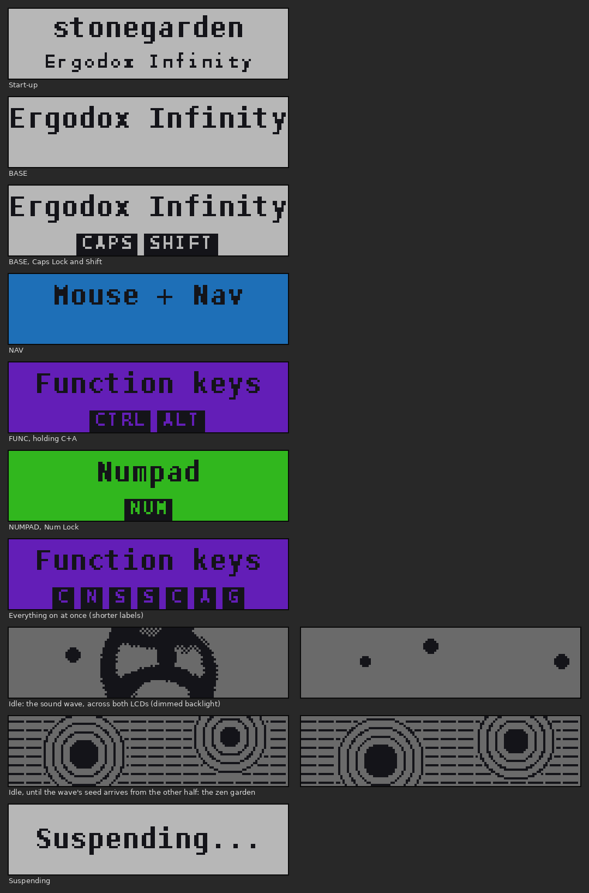
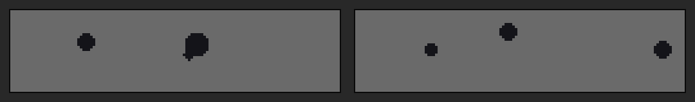

# ErgoDox (Infinity and EZ)

The [ergodox_stonegarden](https://github.com/vehagn/ergodox_stonegarden) keymap, ported to current QMK (0.34.7). The same
keymap builds for the ErgoDox Infinity (`input_club/ergodox_infinity`) and the ErgoDox EZ (`ergodox_ez/base`, `/glow` or
`/shine`). See the [top-level README](../../README.md) for the build environment. ZMK doesn't support either board's
microcontroller, so these are QMK only.

## Layout

The same four layers as the [Ergo68](../ergo68/README.md), with the same keys wherever the two keyboards have the same
keys. The ErgoDox has eight more, all on the thumbs, and they keep their old functions: `C+A`, `PrtSc`, `Home` and `End`
on the left, `FUNC`, `Ins`, `PgUp` and `PgDn` on the right.

* `NAV` is held: either `NAV` key in the bottom row.
* `FUNC` and `NUMPD` latch their layer on, and `BASE` (the key in the same spot) returns to the base layer. Holding `;`
  gives FUNC momentarily.
* Blank keys fall through to the base layer.
* `C+A` on the left thumb is Ctrl+Alt while held and Menu when tapped: hold it, tap `FUNC` and press an F-key for
  Ctrl+Alt+Fx (TTY switching).
* `§` sends the ISO key next to left Shift, so what it types depends on the computer's keyboard layout.
* `Boot` puts the half that's plugged into USB in bootloader mode (see [ErgoDox Infinity](#ergodox-infinity)).

### BASE

```
.------.------.------.------.------.------.------.          .------.------.------.------.------.------.------.
|  \   |  1   |  2   |  3   |  4   |  5   | Esc  |          | Esc  |  6   |  7   |  8   |  9   |  0   |  /   |
|------+------+------+------+------+------+------|          |------+------+------+------+------+------+------|
| Tab  |  Q   |  W   |  E   |  R   |  T   | FUNC |          |NUMPD |  Y   |  U   |  I   |  O   |  P   |  '   |
|------+------+------+------+------+------|      |          |      |------+------+------+------+------+------|
|  `   |  A   |  S   |  D   |  F   |  G   |------|          |------|  H   |  J   |  K   |  L   |;/FUNC|  =   |
|------+------+------+------+------+------|  [   |          |  ]   |------+------+------+------+------+------|
|Shift |  Z   |  X   |  C   |  V   |  B   |      |          |      |  N   |  M   |  ,   |  .   |  :   |  -   |
'------+------+------+------+------+------+------'          '------+------+------+------+------+------+------'
| Ctrl | Alt  | GUI  |  ~   | NAV  |                                      | NAV  |  $   |  §   | Menu |AltGr |
'------'------'------'------'------'                                      '------'------'------'------'------'
                                        .------.------.  .------.------.
                                        | C+A  |PrtSc |  | FUNC | Ins  |
                                 .------+------+------|  |------+------+------.
                                 |      |      | Home |  | PgUp |      |      |
                                 | Bspc | Del  |------|  |------|Enter |Space |
                                 |      |      | End  |  | PgDn |      |      |
                                 '------'------'------'  '------'------'------'
```

### NAV (hold NAV)

```
.------.------.------.------.------.------.------.          .------.------.------.------.------.------.------.
|      |      |      |      |      |      |      |          |      |      |      |      |      |      |      |
|------+------+------+------+------+------+------|          |------+------+------+------+------+------+------|
|      |      | Back | Btn1 | Btn2 | Fwd  | BASE |          | BASE |      |      |      |      |      |      |
|------+------+------+------+------+------|      |          |      |------+------+------+------+------+------|
|      |      |  M←  |  M↓  |  M↑  |  M→  |------|          |------| Left | Down |  Up  |Right |      |      |
|------+------+------+------+------+------| Btn3 |          |      |------+------+------+------+------+------|
|      |      |  W←  |  W↓  |  W↑  |  W→  |      |          |      | Home | PgDn | PgUp | End  |      |      |
'------+------+------+------+------+------+------'          '------+------+------+------+------+------+------'
|      |      |      |      |      |                                      |      |      |      |      |      |
'------'------'------'------'------'                                      '------'------'------'------'------'
                                        .------.------.  .------.------.
                                        |      |      |  |      |      |
                                 .------+------+------|  |------+------+------.
                                 |      |      |      |  |      |      |      |
                                 |      |      |------|  |------|      |      |
                                 |      |      |      |  |      |      |      |
                                 '------'------'------'  '------'------'------'
```

### FUNC (tap FUNC or hold `;`)

The lighting keys control the Infinity's per-key backlight (`Light` on/off, `On`, `Off`, `Mode`, brightness `Bri`;
`Hue` and `Sat` do nothing there), the EZ Glow's RGB matrix or the EZ Shine's underglow (where `On`/`Off` do
nothing). On the plain EZ they do nothing. `NKRO` switches n-key rollover on and off.

```
.------.------.------.------.------.------.------.          .------.------.------.------.------.------.------.
| Sat+ |  F1  |  F2  |  F3  |  F4  |  F5  |      |          |      |  F6  |  F7  |  F8  |  F9  | F10  | F11  |
|------+------+------+------+------+------+------|          |------+------+------+------+------+------+------|
| Sat- |Mode+ |      |      |      |      | BASE |          | BASE | Ins  |ScrLk |PrtSc |Pause |      | F12  |
|------+------+------+------+------+------|      |          |      |------+------+------+------+------+------|
| Bri+ |Light |Mode+ |Mode- | Hue+ | Hue- |------|          |------| Prev | Vol- | Vol+ | Next |      | Play |
|------+------+------+------+------+------|      |          |      |------+------+------+------+------+------|
| Bri- | Off  |      |      |      |      |      |          |      | Rew  | Mute |      |  FF  |      | Stop |
'------+------+------+------+------+------+------'          '------+------+------+------+------+------+------'
| Boot |      |      |      |      |                                      |      |      |      |      | Boot |
'------'------'------'------'------'                                      '------'------'------'------'------'
                                        .------.------.  .------.------.
                                        | NKRO |      |  | BASE |      |
                                 .------+------+------|  |------+------+------.
                                 |      |      |      |  |      |      |      |
                                 |  On  | Off  |------|  |------|      |      |
                                 |      |      |      |  |      |      |      |
                                 '------'------'------'  '------'------'------'
```

### NUMPAD (tap NUMPD)

```
.------.------.------.------.------.------.------.          .------.------.------.------.------.------.------.
| Boot |      |      |      |      |      |      |          |      |      |NumLk |  /   |  *   |  -   |      |
|------+------+------+------+------+------+------|          |------+------+------+------+------+------+------|
|Reboot|      |      |      |      |      | BASE |          | BASE |      |  7   |  8   |  9   |  +   |      |
|------+------+------+------+------+------|      |          |      |------+------+------+------+------+------|
|EEClr |      |      |      |      |      |------|          |------|      |  4   |  5   |  6   |  ,   |      |
|------+------+------+------+------+------|      |          |      |------+------+------+------+------+------|
|      |      |      |      |      |      |      |          |      |      |  1   |  2   |  3   |  =   |      |
'------+------+------+------+------+------+------'          '------+------+------+------+------+------+------'
|      |      |      |      |      |                                      |      |  0   |  .   |  ,   |      |
'------'------'------'------'------'                                      '------'------'------'------'------'
                                        .------.------.  .------.------.
                                        |      |      |  |      |      |
                                 .------+------+------|  |------+------+------.
                                 |      |      |      |  |      |      |      |
                                 |      |      |------|  |------|      |      |
                                 |      |      |      |  |      |      |      |
                                 '------'------'------'  '------'------'------'
```

## What changed from the old repository

* **The Ergo68's layout.** The layers are now the Ergo68's: BASE, NAV (held, mouse keys and navigation), FUNC
  (F-keys, media and lighting) and NUMPAD. The old MEDIA layer is gone; its media and lighting keys are on FUNC and the
  mouse keys on NAV. Old keycode names are updated (`RESET` → `QK_BOOT`, `EEP_RST` → `EE_CLR`, mouse keys → `MS_*`,
  `MAGIC_TOGGLE_NKRO` → `NK_TOGG`).
* **The LCDs (Infinity).** QMK's old LCD "visualizer" no longer exists; the LCDs now use QMK's ST7565 driver, drawn
  by this keymap ([The LCDs](#the-lcds)). As before, both halves show the active layer's name in a bold font, the
  backlight takes the layer's colour (the old visualizer's colours) and fades between colours, and there's a start-up
  screen and a *Suspending...* screen. New: badges for active locks and modifiers, and an idle animation.
* **Lighting keys on FUNC.** The old RGB and backlight keys now control whatever lighting the board has: the per-key
  backlight on the Infinity (on/off, effect, brightness, speed), RGB matrix on the EZ Glow, RGB underglow on the EZ Shine.
  On the plain EZ they do nothing. The RGB mode keys (plain, breathing, rainbow, …) are gone.
* **The EZ's three LEDs** show which of NAV, FUNC and NUMPAD are on.
* **One firmware for both Infinity halves.** There's no `MASTER=right` build any more; plug the left half into the
  computer.

## ErgoDox Infinity

Build with `just ergodox-infinity`, which gives `build/ergodox_infinity.bin`. Each half is flashed separately with
the same file:

1. Run `just flash-ergodox-infinity` on your own machine (it uses dfu-util, which may need `sudo` or a udev rule). It
   waits for a half in bootloader mode.
2. Put the half that's plugged into USB in bootloader mode, see below.
3. Do the same for the other half.

**Bootloader mode without the program button.** The program button is on the back (above the thumb cluster), behind
the case. With this firmware already on the keyboard, a key does the same for the half that's plugged into USB:

* **Left half** (normal use, USB in the left half): tap `FUNC` (left half, inner column, second row) and press the
  bottom-left key (`Ctrl`). Holding `;` and pressing the bottom-left key works too.
* **Right half:** plug USB into the right half instead. The half on USB always acts as the left half, and on the
  Infinity every key has the same matrix position as its mirror image on the other half, so the right half's keys now
  do what their left-hand mirror images do. Tap the right half's inner-column key in the second row (normally `NUMPD`,
  now `FUNC`), then press its bottom-right key (normally `AltGr`, now `Boot`). This only uses the right half, so it
  works with the halves disconnected.

Keymap changes only need the left half flashed: the half on USB runs the keymap, the other only reports its key
presses. After a QMK update, flash both halves so their split protocol matches.

Then connect the halves and plug the left half into the computer. If you'd rather be able to plug in either half, add
`#define EE_HANDS` to `config.h` and set each half's side once as described in QMK's
[ErgoDox Infinity readme](https://github.com/qmk/qmk_firmware/tree/master/keyboards/input_club/ergodox_infinity).

### The LCDs



* **Both halves** show the active layer's name, centred, and below it a badge for each active lock (Caps, Num, Scroll)
  and modifier (Shift, Ctrl, Alt, GUI). Holding `C+A` shows Ctrl and Alt, for example. If they don't all fit, the
  labels get shorter.
* **The backlight** takes the layer's colour: white for BASE, blue for NAV, purple for FUNC, green for NUMPAD. It fades
  between colours, fades in behind the *stonegarden* start-up screen, and fades out on *Suspending...*.
* **When idle** (30 seconds without a key press on either half), both LCDs together show a simulated sound wave: drops
  fall at random, and their waves spread, scatter off up to five small disks, bounce between the top and bottom and
  leave at the far ends. The
  backlight dims to a quarter, and the next key press brings everything back. After 5 minutes without key presses the
  LCDs turn off.



The wave really is simulated: `lcd_wave.c` solves the 2D wave equation with the usual explicit finite-difference scheme,
in integers, 20 steps a second on a 256 x 32 grid (one cell per pixel, both LCDs).

* **The disks** (1 to 5, radius 2 to 4 pixels, at random places) are rigid: no flow into them (a Neumann boundary), so
  waves reflect off them as off a solid object.
* **A corridor:** the top and bottom edges are rigid too, and the left and right ends absorb, with Mur's first-order
  absorbing boundary condition: each end cell is set as if the wave carried on past it. Measured on this grid, a drop's
  waves stay visible for about 13 seconds this way. With all four edges absorbing they were gone within a second or
  two, since the top and bottom are never more than 16 pixels away. (Mur's condition lets out all but 1% of a pulse's
  energy within 15 seconds where it's used; a few cells of graded damping in front of the edges, a cheap stand-in for
  a perfectly matched layer, did worse than Mur alone.)
* **Viscosity** takes out the grid's pixel-scale ripples (numerical dispersion), which made the screen speckled: like
  air, it damps short wavelengths far more than long ones. High crests are drawn solid and a band below them as a
  checkerboard, for soft edges; a finer dither showed the faint ripples as scattered dots. `WAVE_CREST` and
  `WAVE_VISCOSITY` in `lcd_wave.c` trade how long waves stay visible (lower) against how calm the screen gets between
  drops (higher).

Each half simulates the whole grid; the half on USB picks the random seed (disks and drops) and sends it to the other
over the cable, and the integer maths gives both exactly the same wave. If the seed doesn't arrive, that half shows a
zen stone garden instead.

The timings are at the top of the LCD code in `keymap.c` (`LCD_IDLE_MS`, `LCD_WAVE_STEP_MS` and the fades) and in
`config.h` (`ST7565_TIMEOUT`, when the LCDs turn off); the wave's disks, drops and calm threshold are at the top of
`lcd_wave.c`.

The text is DejaVu Sans Mono, monospaced, rendered without anti-aliasing: bold at 12 px for the big line and 8 px for
the badges. `lcd_font.h` is generated from the font by `just ergodox-lcd-font` (`scripts/lcd_font.py`), and the drawing is
in `lcd.c`. `just ergodox-lcd-preview` compiles that same `lcd.c` on your machine and renders every screen to
`lcd_preview.png` and the wave to `lcd_wave.gif` (the pictures above), so you can see a change before you flash it.

## ErgoDox EZ

Build with `just ergodox-ez`, which gives `build/ergodox_ez_base.hex`. For the EZ Glow or Shine, build with
`just ez_variant=glow ergodox-ez` or `just ez_variant=shine ergodox-ez` so their lights work.

Flash it with ZSA's [Keymapp](https://www.zsa.io/flash) (choose the `.hex` file), QMK Toolbox, or
`just flash-ergodox-ez` (teensy_loader_cli) on your own machine. Press the reset button (the small hole on the top right)
or `Boot` when it asks.
